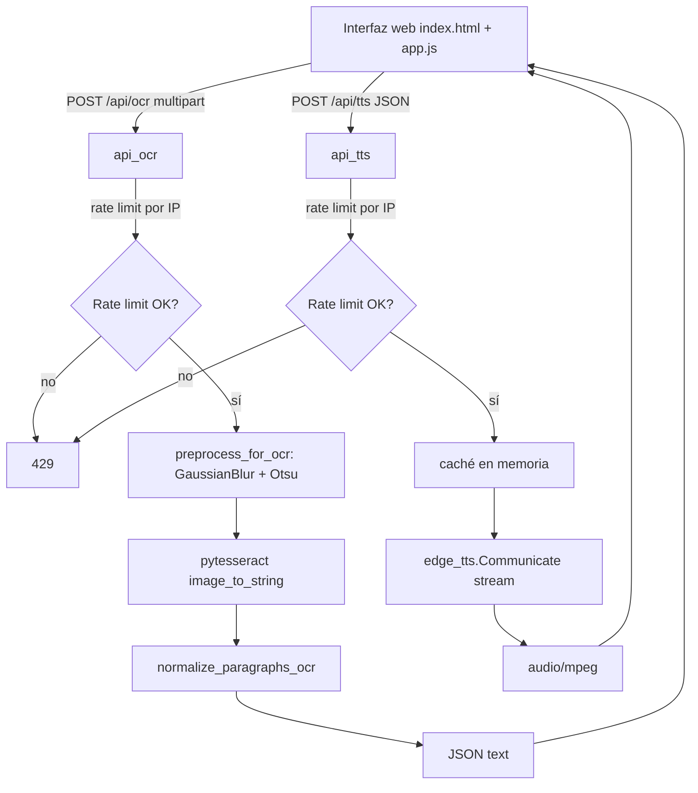

# web-imagevoice

Aplicación web que extrae texto de imágenes subidas con Tesseract OCR y lo lee en voz alta usando Microsoft Edge TTS.

[](LICENSE)
[](https://python.org)
[](https://flask.palletsprojects.com/)
[](https://github.com/tesseract-ocr/tesseract)
[](https://github.com/rany2/edge-tts)
[](https://github.com/bi0punk/web-imagevoice/actions)

## Contenido

- [Características](#características)
- [Arquitectura](#arquitectura)
- [Stack](#stack)
- [Estructura del repositorio](#estructura-del-repositorio)
- [Instalación](#instalación)
- [Uso](#uso)
- [API](#api)
- [Configuración](#configuración)
- [Tests / CI](#tests--ci)
- [Producción](#producción)
- [Roadmap](#roadmap)
- [Licencia](#licencia)

## Características

- **OCR multilingüe**: soporte español (`spa`) y otros idiomas Tesseract
- **Text-to-Speech**: síntesis de voz natural con Microsoft Edge TTS
- **Preprocesamiento de imagen**: Gaussian blur + Otsu threshold para mejor OCR
- **Normalización de párrafos**: reconstrucción automática de párrafos y bullets
- **API REST**: endpoints para OCR y TTS
- **Interfaz web**: subida de imágenes, drag & drop, pegado desde portapapeles y reproducción de audio

## Arquitectura



## Stack

| Componente | Tecnología |
|---|---|
| Backend | Python 3.11+, Flask 3.0+ |
| OCR | Tesseract (pytesseract) + OpenCV + PIL |
| TTS | Microsoft Edge TTS (edge-tts) |
| Procesamiento | OpenCV, NumPy |
| Frontend | HTML5, CSS3, JavaScript |
| Servidor | Gunicorn (producción) |
| Testing | pytest |

## Estructura del repositorio

```
web-imagevoice/
├── app.py                  # Aplicación Flask principal
├── static/
│   └── app.js              # Lógica de OCR/TTS en el navegador
├── templates/
│   └── index.html          # Interfaz web
├── tests/
│   └── test_smoke.py
├── out/                    # Archivos de salida (audio)
├── .env.example
├── .github/workflows/
│   └── ci.yml
├── pyproject.toml
├── requirements.txt
└── README.md
```

## Instalación

```bash
git clone https://github.com/bi0punk/web-imagevoice.git
cd web-imagevoice
python3 -m venv .venv
source .venv/bin/activate
pip install -r requirements.txt
```

Requisitos:
- Python 3.11+
- Tesseract OCR instalado en el sistema
- Conexión a internet (para Edge TTS)

### Instalar Tesseract

```bash
# Ubuntu/Debian
sudo apt install tesseract-ocr tesseract-ocr-spa

# macOS
brew install tesseract

# Arch Linux
sudo pacman -S tesseract tesseract-data-spa
```

## Uso

```bash
python app.py
```

Abrir [http://localhost:5000](http://localhost:5000) en el navegador.

### Flujo de uso

1. Sube una imagen con texto (JPG, PNG) — también soporta arrastrar y pegar
2. El sistema extrae el texto mediante OCR
3. Escucha el texto convertido a voz con Edge TTS

## API

| Método | Endpoint | Descripción |
|---|---|---|
| POST | `/api/ocr` | Extraer texto de imagen subida |
| POST | `/api/tts` | Convertir texto a audio MP3 |

### `/api/ocr`

**Request:** multipart/form-data con campo `image`

**Response:**
```json
{
  "ok": true,
  "text": "Texto extraído de la imagen"
}
```

### `/api/tts`

**Request:**
```json
{
  "text": "Texto a convertir",
  "voice": "es-CL-CatalinaNeural",
  "rate": "+0%",
  "volume": "+0%"
}
```

**Response:** Audio MP3

## Configuración

Variables de entorno (ver `.env.example`):

| Variable | Default | Descripción |
|---|---|---|
| `IMGVOICE_HOST` | `127.0.0.1` | Host de escucha |
| `IMGVOICE_PORT` | `5000` | Puerto |
| `IMGVOICE_RATE_LIMIT` | `10` | Peticiones máximas por minuto por IP |
| `IMGVOICE_OCR_LANG` | `spa` | Idioma para OCR |
| `IMGVOICE_VOICE` | `es-CL-CatalinaNeural` | Voz de Edge TTS |
| `IMGVOICE_RATE` | `+0%` | Velocidad de habla |
| `IMGVOICE_VOLUME` | `+0%` | Volumen |
| `IMGVOICE_MAX_TEXT` | `500` | Longitud máxima de texto para TTS |

Rate limiting: 10 peticiones/minuto por IP en ambos endpoints (`/api/ocr`, `/api/tts`). Caché TTS en memoria para evitar regenerar audio idéntico.

## Tests / CI

```bash
pip install pytest
pytest tests/ -v
```

GitHub Actions ejecuta lint (Ruff) y tests (pytest) en cada push/PR.

## Producción

Para producción, usa Gunicorn con reverse proxy:

```bash
pip install gunicorn
gunicorn -w 4 -b 0.0.0.0:5000 app:app
```

Asegúrate de:
- `DEBUG=false` (por defecto)
- Usar reverse proxy con HTTPS (nginx, Caddy)
- Configurar `MAX_CONTENT_LENGTH` apropiado (8 MB por defecto)

## Roadmap

- [x] OCR con Tesseract + preprocesamiento OpenCV
- [x] TTS con Microsoft Edge
- [x] API REST + interfaz web
- [ ] Soporte para PDFs multi-página
- [ ] Traducción automática del texto extraído
- [ ] Descarga del audio generado
- [ ] Soporte más voces Edge TTS
- [ ] Historial de conversiones
- [ ] Modo batch (múltiples imágenes)

## Licencia

MIT